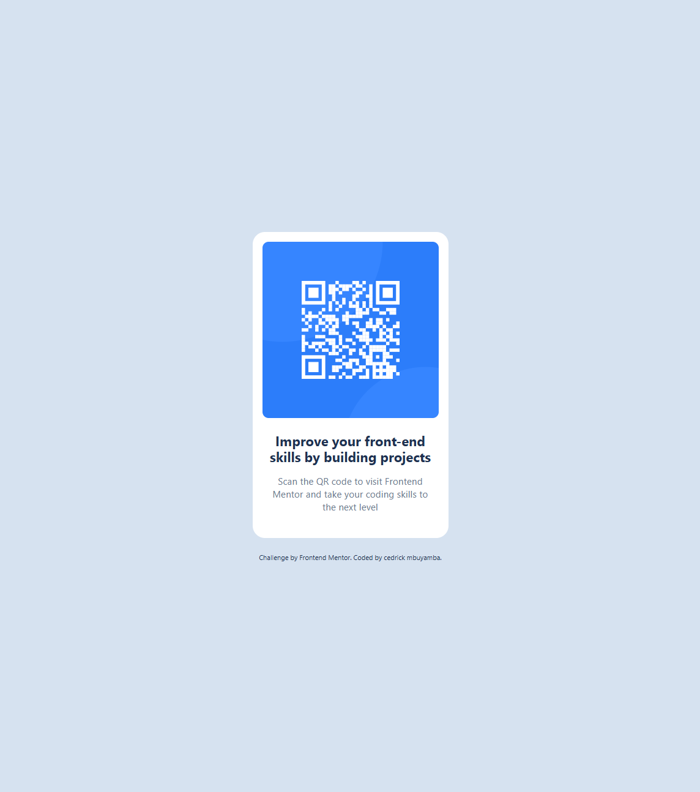

# Frontend Mentor - QR code componen

This is a solution to the [QR code component challenge on Frontend Mentor](https://www.frontendmentor.io/challenges/qr-code-component-iux_sIO_H). Frontend Mentor challenges help me improve my coding skills by building realistic projects.

## Table of contents

- [Overview](#overview)
- [Screenshot](#screenshot)
- [Links](#links)
- [My process](#my-process)
- [Built with](#built-with)
- [What I learned](#what-i-learned)
- [Continued development](#continued-development)
- [Author](#author)

## Overview

### Screenshot

## My process

### Built with

- Semantic HTML
- CSS
- Flexbox for centering and layout alignment
- Weights: 400, 700

### What I learned

Working through this challenge helped reinforce foundational HTML and CSS concepts, including:
- Translating a Figma design and `style-guide.md` specifications (colors, typography, spacing) into clean code.
- Structuring a clean card component using semantic HTML tags (`<main>`, ``, `<h1>`, `
`).
- Centering a component vertically and horizontally on the viewport using Flexbox:

### Continued development

In future projects, I want to continue practicing:
- Working directly from Figma design files to measure exact padding, margins, and font sizes.
- Writing cleaner, more reusable CSS classes.

## Author

- **GitHub:** [@cedrickmmk](https://github.com)

